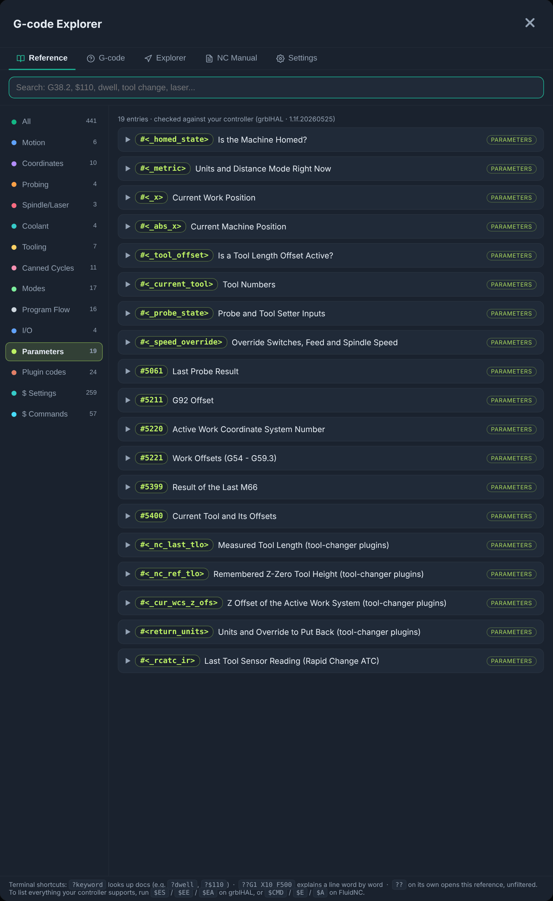
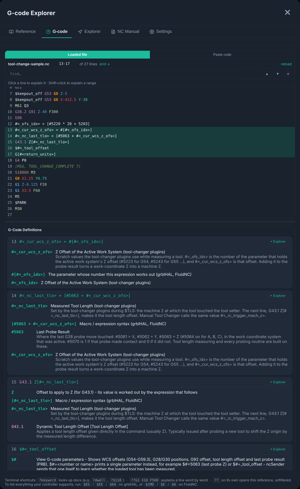

## What's Changed in 2.2.0

The reference has caught up with ncSender 2.0.228, every plugin in the ncSender registry and grblHAL build 20261117: 39 new entries, and the G-code tab now explains a tool change line by line.

### 🅿️ ncSender's own commands
- **`$PARK`**: does what holding the Park button does (up to Safe Z, then across to your saved parking spot). Works in the console, a program, a macro or an event field such as Program End (ncSender 2.0.223 or later)
- **`$SAFEZ`**: raises to your Safe Z height and leaves the program's inch/mm setting alone (ncSender 2.0.228 or later)
- **`$keepout_off`**: the prefix tool-changer plugins put on their rack moves in ncSender Pro, so one move may enter an ATC zone
- **`$NCSENDER_CLEAR_MSG`**: clears a saved plugin prompt
- **`M3`** now says when ncSender refuses to start the spindle: with a probe loaded, or a tool set up as a Drag Knife or Pen

### 🔢 New category: Parameters
The `#` values you see in macros, probing routines and plugin-made files now have their own category, and the G-code tab explains each one where it is used:
- **grblHAL's own**: `#5061`–`#5063` (last probe result), `#5220` (active work system), `#5221`… (work offsets), `#5211`… (G92), `#5399` (result of `M66`), `#5400`… (tool and its offsets), `#<_homed_state>`, `#<_metric>`, `#<_x>`, `#<_abs_x>`, `#<_tool_offset>`, `#<_current_tool>`, `#<_probe_state>`, `#<_speed_override>` and their relatives
- **Set by tool-changer plugins** (Rapid Change ATC, Manual Tool Changer, Pneumatic ATC): `#<_nc_last_tlo>`, `#<_nc_ref_tlo>`, `#<_cur_wcs_z_ofs>`, `#<return_units>`, `#<_rcatc_ir>`
- Each one shows whether it works on Grbl 1.1 and FluidNC, like every other entry

### 🔁 Tool changes, explained line by line
Turn on "show macro commands" in a tool-changer plugin and the G-code tab can now read what it sends:
- **Markers** are recognized instead of being called plain comments: `(MSG, TOOL_CHANGE_START …)` / `TOOL_CHANGE_COMPLETE`, `(MSG, ZERO_KEEP_START …)` / `ZERO_KEEP_END`, plugin prompts such as `(MSG, PLUGIN_RAPIDCHANGEATC:…)`, and `(GATE_ABORT)` … `(GATE_END)` blocks
- **Words with a worked-out value** are no longer flagged as invalid G-code: `G43.1 Z[#<_nc_last_tlo>]`, `G10 L2 P[#5220] Z[…]`, `G[#<return_units>]`, and `#[…]` (a parameter looked up by number)
- Parameters inside an expression are explained too, once per line

The lines a tool-changer plugin sends to measure a tool, on a 1080×1920 screen.

### ⚙️ grblHAL: new and changed
- **New settings**: `$701` Rotary options, `$703` MPG auto report interval, `$720` MPG baud rate
- **`$60`** is now "End program actions" (adds Restore G54), **`$63`** gains "Set RPM to minimum" during a feed hold, **`$10`** gains the Extended option; the spindle delays `$392`, `$394` and `$539` go up to 60 s
- **`G41` / `G42`** cutter compensation (experimental, and only in firmware built with it)
- **More `$` commands**: `$HELP`, `$B` / `$O` / `$S` (block delete, optional stop, single block), `$LIM` / `$HSS` / `$LEV` (switch states), `$PORTS`, `$RTC`, `$SDS`, `$DFU` and `$DWNGRD`
- **More forms of existing ones**: `$<n>` and `$$=<n>` (one setting), `$#=<n>` (one parameter), `$I+`, `$ESH`, and `$FMD` / `$FRD` (make and remove a folder on the SD card)

### 🔌 Plugins
- **Dust Docker**: type `#<_dust_boot_attached>` on its own to ask where the boot is, and set it to `UNKNOWN` to be asked before the next tool change

### 🔧 Fixes
- **`$394`** was described as the spindle *off* delay. It is the spindle *on* delay; the off delay is `$539`
- When a line uses a parameter your controller doesn't have, the G-code tab names that parameter
